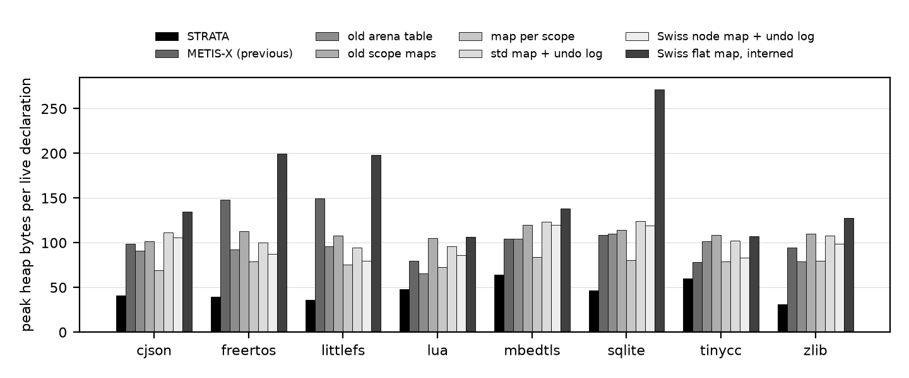
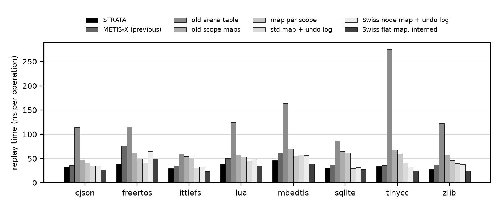

# Results

Run `20261011-161306-final`. Generated by `scripts/make_report.py`; every number is computed from `results/summary/20261011-161306-final/` and `results/raw/20261011-161306-final/`. Full tables: `results/summary/20261011-161306-final/tables.md`.

```
run: results/raw/20261011-161306-final
date_utc: 2026-10-11T16:13:24Z
git_commit: 3aee3811874f05212b8108fe70cb3a75051613fb
compiler: g++ (Ubuntu 11.4.0-1ubuntu1~22.04.3) 11.4.0
flags: -std=c++14 -O2
kernel: Linux 6.18.33.2-microsoft-standard-WSL2
cpu: Intel(R) Core(TM) Ultra 7 258V
libc: ldd (Ubuntu GLIBC 2.35-0ubuntu3.15) 2.35
pinning: taskset -c 2
repetitions: 15 (+2 warm-up) whole-trace replays; 3 per-operation latency replays
metis: 7b3dacfa5405ec3e6a03b718f485b473d779123d
phmap: v1.4.1
```

Reduction always means `(baseline - STRATA) / baseline x 100`. A negative reduction means STRATA is worse.

## Summary

| Hypothesis / target | Outcome |
|---|---|
| Correctness: agreement with the reference model | 88 of 88 compiler pairs, 98 of 99 synthetic pairs, 42 of 42 legacy pairs have no wrong or refused result. The only failures are METIS-X on `deep_shadow_400`. |
| H1 memory: below every other table on compiler traces | **Holds on all 8 traces.** Peak heap 23.3 to 75.9% below METIS-X (median 57.6%). |
| H2 time: replay not slower than METIS-X | **Holds on all 8 traces** (5.8 to 48.7% lower, median 20.7%); on 3 of them (cjson, sqlite, tinycc) the 95% intervals overlap, so the difference is not established there. |
| H3 fixed memory: whole trace from one buffer, no allocator | **Holds.** Minimum buffer 15.8 to 156.5 KiB, 27.0 to 35.6 bytes per live declaration. |
| 85% target, allocator calls vs METIS-X | **Met on all traces** (98.7 to 99.9%). |
| 85% target, memory vs METIS-X | **Not met.** Best case 75.9% (peak heap) and 81.3% (fixed buffer against METIS-X's peak heap). |
| 85% target, memory vs any baseline | Met only against the interning Swiss map, in fixed-buffer mode, on 2 of 8 traces (littlefs, sqlite). |
| 85% target, any latency or time metric | **Not met.** |
| Lookup latency vs METIS-X | **Not improved**: p95 changes by -44.4 to 20.2% across traces, both signs. |
| Scope-exit latency vs METIS-X | **Worse on every compiler trace**: p95 -57.5 to -12.7%. |
| Speed vs the fastest baseline (`swiss_interned`) | STRATA is slower on 7 of 8 traces (replay time -33.3 to 20.5%, median -15.9%), with 43.6 to 82.7% less peak heap. |

## A. Compiler traces

### Workloads

| trace    |   units |    ops |   declares |   lookups |   enters |   distinct_names |   peak_live_decls |   peak_live_distinct |   max_depth |
|:---------|--------:|-------:|-----------:|----------:|---------:|-----------------:|------------------:|---------------------:|------------:|
| cjson    |       2 |  20874 |       5247 |      9194 |     3216 |             1366 |              1067 |                 1067 |          10 |
| freertos |       9 |  37875 |      10346 |     17417 |     5052 |             2226 |              1505 |                 1505 |          16 |
| littlefs |       2 |  21080 |       3835 |     12230 |     2507 |             1001 |               732 |                  732 |          16 |
| lua      |      34 | 188509 |      58619 |     86887 |    21485 |             3622 |              1365 |                 1365 |          14 |
| mbedtls  |     105 | 983008 |     319886 |    438876 |   112071 |             7622 |              2302 |                 2302 |          14 |
| sqlite   |       1 | 268960 |      27072 |    172426 |    34731 |             7801 |              4245 |                 4245 |          22 |
| tinycc   |       1 |  89135 |      13776 |     54623 |    10368 |             6704 |              5509 |                 5508 |          27 |
| zlib     |      15 |  58058 |      16341 |     27405 |     7149 |             1041 |               571 |                  571 |          23 |

At the peak, live declarations equal distinct live names on every trace except one (`tinycc`, by one): TCC-compiled C has almost no shadowing at the moment of peak memory, so storing a name once does not by itself save memory here.

### Previous implementation versus STRATA

| trace    |   peak heap KiB old |   new |   peak heap red. % |   allocs old |   allocs new |   allocs red. % |   replay ms old |   replay ms new |   replay red. % | intervals overlap   |   lookup p95 old |   lookup p95 new |   lookup p95 red. % |   declare p95 red. % |   exit p95 red. % |   old refused |
|:---------|--------------------:|------:|-------------------:|-------------:|-------------:|----------------:|----------------:|----------------:|----------------:|:--------------------|-----------------:|-----------------:|--------------------:|---------------------:|------------------:|--------------:|
| cjson    |               102.7 |  42.8 |               58.3 |         3604 |           22 |            99.4 |             0.8 |             0.7 |            11   | yes                 |             66   |             52.7 |                20.2 |                 51.9 |             -44.8 |             0 |
| freertos |               217.4 |  57.8 |               73.4 |         8282 |           81 |            99   |             2.9 |             1.5 |            48.7 | no                  |             65.4 |             55.7 |                14.8 |                 62.7 |             -20.5 |             0 |
| littlefs |               106.9 |  25.8 |               75.9 |         2774 |           19 |            99.3 |             0.7 |             0.6 |            14.4 | no                  |             49.7 |             58.1 |               -16.9 |                 53.3 |             -12.7 |             0 |
| lua      |               106.8 |  64.2 |               39.9 |        40494 |          336 |            99.2 |             9.4 |             7.3 |            22.7 | no                  |             54.5 |             78.7 |               -44.4 |                 41.7 |             -53.9 |             0 |
| mbedtls  |               234.4 | 144.3 |               38.5 |       255849 |         1154 |            99.5 |            61   |            45.9 |            24.8 | no                  |             73.9 |             71.5 |                 3.2 |                 50.5 |             -54.7 |             0 |
| sqlite   |               451.1 | 194.7 |               56.8 |        22711 |           15 |            99.9 |             9.9 |             8.1 |            18.7 | yes                 |             64.2 |             56.9 |                11.4 |                 56.8 |             -36   |             0 |
| tinycc   |               423.1 | 324.5 |               23.3 |         9665 |           15 |            99.8 |             3.2 |             3   |             5.8 | yes                 |             51.5 |             61.7 |               -19.8 |                 20.2 |             -57.5 |             0 |
| zlib     |                52.6 |  17.2 |               67.3 |        10412 |          133 |            98.7 |             2.1 |             1.6 |            23.9 | no                  |             46   |             47.8 |                -3.9 |                 54.1 |             -50.5 |             0 |

Sources: `results/summary/20261011-161306-final/compiler_old_vs_new.csv`; raw: `compiler_summary.csv`, `compiler_replays.csv`; script: `benchmarks/bench_main.cpp`.

### Peak heap, KiB

| trace    |   STRATA |   METIS-X |   map/scope |   std+undo |   Swiss+undo |   Swiss int. |
|:---------|---------:|----------:|------------:|-----------:|-------------:|-------------:|
| cjson    |     42.8 |     102.7 |        72   |      116.1 |        109.9 |        140.4 |
| freertos |     57.8 |     217.4 |       116   |      147.3 |        128.8 |        293.1 |
| littlefs |     25.8 |     106.9 |        54.1 |       67.8 |         57.2 |        141.9 |
| lua      |     64.2 |     106.8 |        96.7 |      127.7 |        114.8 |        142.3 |
| mbedtls  |    144.3 |     234.4 |       189.4 |      277.7 |        269.3 |        310.8 |
| sqlite   |    194.7 |     451.1 |       333.1 |      513.5 |        494   |       1125.5 |
| tinycc   |    324.5 |     423.1 |       424.5 |      550.9 |        449.5 |        575.5 |
| zlib     |     17.2 |      52.6 |        44.4 |       60.3 |         55.1 |         71.1 |



### Replay time, ns per trace operation (median of 15)

| trace    |   STRATA |   METIS-X |   map/scope |   std+undo |   Swiss+undo |   Swiss int. |   STRATA sparse |   STRATA raw |   STRATA no-shrink |
|:---------|---------:|----------:|------------:|-----------:|-------------:|-------------:|----------------:|-------------:|-------------------:|
| cjson    |     32.2 |      36.2 |        41.6 |       35.1 |         35.4 |         26.3 |            28.2 |         30.7 |               32.6 |
| freertos |     39.2 |      76.5 |        49   |       41.9 |         64.3 |         49.3 |            33.7 |         35.9 |               40.4 |
| littlefs |     29.8 |      34.8 |        51.6 |       31.2 |         32.4 |         23.4 |            25.6 |         29.8 |               29.8 |
| lua      |     38.7 |      50   |        53.1 |       44.9 |         48.7 |         34.3 |            33.3 |         39.8 |               52.2 |
| mbedtls  |     46.7 |      62   |        56.1 |       57.3 |         56.9 |         39.2 |            43.5 |         42.4 |               46.1 |
| sqlite   |     30   |      36.9 |        61.6 |       29.6 |         31.8 |         28.1 |            28.2 |         30.3 |               39.7 |
| tinycc   |     33.6 |      35.6 |        59.3 |       42   |         32.4 |         25.2 |            28.2 |         32.8 |               33.5 |
| zlib     |     27.8 |      36.5 |        46.7 |       40.2 |         38.2 |         24.8 |            24.2 |         27.6 |               29   |

Interquartile range of the 15 replays, as a percentage of the median: median 14.3%, 90th percentile 26.7%, maximum 53.7% over the 88 table/trace pairs. Per-pair 95% bootstrap intervals are in `compiler_replay_time.csv`.



### STRATA against every baseline

| baseline                  |   traces |   peak heap red. % min |   median |   max |   replay time red. % min |   median  |   max  |
|:--------------------------|---------:|-----------------------:|---------:|------:|-------------------------:|----------:|-------:|
| METIS-X (previous)        |        8 |                   23.3 |     57.6 |  75.9 |                      5.8 |      20.7 |   48.7 |
| old arena table           |        8 |                   26.6 |     56.1 |  62.4 |                     50.4 |      70.3 |   87.8 |
| old scope maps            |        8 |                   44.6 |     59.2 |  72   |                     32.3 |      41.1 |   53.3 |
| map per scope             |        8 |                   23.6 |     41   |  61.2 |                     16.8 |      33.8 |   51.2 |
| std map + undo log        |        8 |                   41.1 |     61.4 |  71.5 |                     -1.5 |      11.1 |   31   |
| Swiss node map + undo log |        8 |                   27.8 |     55.1 |  68.8 |                     -3.4 |      13.5 |   39   |
| Swiss flat map, interned  |        8 |                   43.6 |     72.7 |  82.7 |                    -33.3 |     -15.9 |   20.5 |

### Lookup latency p95, ns

| trace    |   STRATA |   METIS-X |   map/scope |   std+undo |   Swiss+undo |   Swiss int. |   STRATA sparse |
|:---------|---------:|----------:|------------:|-----------:|-------------:|-------------:|----------------:|
| cjson    |       53 |        66 |         109 |         59 |           45 |           45 |              48 |
| freertos |       56 |        65 |         124 |         58 |           87 |           85 |              51 |
| littlefs |       58 |        50 |         128 |         51 |           47 |           47 |              46 |
| lua      |       79 |        54 |         116 |         85 |           56 |           54 |              81 |
| mbedtls  |       72 |        74 |         127 |         73 |           58 |           64 |              61 |
| sqlite   |       57 |        64 |         183 |         88 |           63 |           74 |              55 |
| tinycc   |       62 |        52 |         141 |         75 |           48 |           48 |              47 |
| zlib     |       48 |        46 |         110 |         52 |           44 |           82 |              45 |

### Declare latency p95, ns

| trace    |   STRATA |   METIS-X |   map/scope |   std+undo |   Swiss+undo |   Swiss int. |   STRATA sparse |
|:---------|---------:|----------:|------------:|-----------:|-------------:|-------------:|----------------:|
| cjson    |       74 |       155 |         108 |        115 |          106 |           73 |              63 |
| freertos |       82 |       221 |         122 |        119 |          194 |          156 |              65 |
| littlefs |       90 |       192 |         117 |        120 |          105 |           78 |              63 |
| lua      |       96 |       164 |         114 |        160 |          118 |           88 |             102 |
| mbedtls  |       98 |       198 |         139 |        133 |          122 |          116 |              75 |
| sqlite   |       84 |       195 |         150 |        183 |          113 |          190 |              78 |
| tinycc   |      146 |       183 |         108 |        169 |          104 |           87 |              65 |
| zlib     |       70 |       152 |         119 |        113 |          105 |          132 |              59 |

### Scope-exit latency p95, ns

| trace    |   STRATA |   METIS-X |   map/scope |   std+undo |   Swiss+undo |   Swiss int. |   STRATA sparse |
|:---------|---------:|----------:|------------:|-----------:|-------------:|-------------:|----------------:|
| cjson    |       92 |        64 |          41 |        122 |          120 |           10 |              77 |
| freertos |      118 |        98 |          65 |        149 |          251 |           32 |              98 |
| littlefs |      124 |       110 |          59 |        147 |          145 |           15 |              93 |
| lua      |      130 |        84 |          60 |        187 |          166 |           18 |             139 |
| mbedtls  |      171 |       111 |          84 |        220 |          211 |           25 |             137 |
| sqlite   |      100 |        74 |          66 |        173 |          139 |           28 |              94 |
| tinycc   |      121 |        77 |          51 |        175 |          116 |           15 |              82 |
| zlib     |       98 |        65 |          59 |        142 |          136 |           27 |              85 |

Per-call values include a serialising timestamp read on each side; the calibrated cost of an empty interval (19 ns) is subtracted. p50 and p99 are in `compiler_summary.csv`.

## B. Fixed-buffer mode

| trace    |   min buffer KiB (packed) |   min buffer KiB (raw) |   min buffer KiB (sparse index) |   packing saves % |   bytes per live decl |   vs METIS-X (previous) peak heap, red. % |   vs map per scope peak heap, red. % |   vs std map + undo log peak heap, red. % |   vs Swiss flat map, interned peak heap, red. % |
|:---------|--------------------------:|-----------------------:|--------------------------------:|------------------:|----------------------:|------------------------------------------:|-------------------------------------:|------------------------------------------:|------------------------------------------------:|
| cjson    |                      30   |                   31.8 |                            38   |               5.5 |                  28.8 |                                      70.8 |                                 58.3 |                                      74.2 |                                            78.6 |
| freertos |                      44   |                   47.8 |                            52   |               7.9 |                  29.9 |                                      79.8 |                                 62.1 |                                      70.1 |                                            85   |
| littlefs |                      20   |                   21.5 |                            24   |               7   |                  28   |                                      81.3 |                                 63   |                                      70.5 |                                            85.9 |
| lua      |                      35.9 |                   38.1 |                            43.9 |               5.7 |                  27   |                                      66.3 |                                 62.8 |                                      71.8 |                                            74.8 |
| mbedtls  |                      80   |                   87.9 |                            96   |               9   |                  35.6 |                                      65.9 |                                 57.8 |                                      71.2 |                                            74.3 |
| sqlite   |                     140.4 |                  152.9 |                           172.4 |               8.2 |                  33.9 |                                      68.9 |                                 57.9 |                                      72.7 |                                            87.5 |
| tinycc   |                     156.5 |                  168.3 |                           188.5 |               7   |                  29.1 |                                      63   |                                 63.1 |                                      71.6 |                                            72.8 |
| zlib     |                      15.8 |                   16.7 |                            19.8 |               5.6 |                  28.2 |                                      70.1 |                                 64.5 |                                      73.9 |                                            77.9 |

Sources: `results/raw/20261011-161306-final/budget.csv`, `benchmarks/budget_main.cpp`. The baselines cannot run from a fixed buffer; the right-hand columns compare STRATA's buffer with their peak heap.

## Ablations and options (compiler traces)

| Variant | Effect, measured |
|---|---|
| Name packing (`strata` vs `strata_raw`) | minimum buffer 5.5 to 9.0% smaller; replay time between 10.1% slower and 2.8% faster with packing (slower on 5 of 8 traces) |
| Sparse index (`strata_sparse`, load <= 1/2) | replay time 6.2 to 15.9% lower (median 13.3%); minimum buffer 18.2 to 26.7% larger |
| No shrinking (`strata_noshrink`) | on `big_scope_exit` 73.1 ns/op instead of 137.9; on compiler traces within noise |

## C. Synthetic stress traces

| trace           |   peak heap KiB old |    new |   peak heap red. % |   allocs old |   allocs new |   allocs red. % |   replay ms old |   replay ms new |   replay red. % | intervals overlap   |   lookup p95 old |   lookup p95 new |   lookup p95 red. % |   declare p95 red. % |   exit p95 red. % |   old refused |
|:----------------|--------------------:|-------:|-------------------:|-------------:|-------------:|----------------:|----------------:|----------------:|----------------:|:--------------------|-----------------:|-----------------:|--------------------:|---------------------:|------------------:|--------------:|
| big_scope_exit  |               868.2 |  486.6 |               44   |       104082 |          199 |            99.8 |            21.2 |            27.6 |           -30.3 | no                  |              0   |              0   |               nan   |                 39.4 |              -3.9 |             0 |
| deep_nesting    |                57.1 |   21.7 |               62   |       103095 |           14 |           100   |            19.4 |            15.2 |            21.8 | no                  |             66   |             85.4 |               -29.4 |                 49.1 |              -5.1 |             0 |
| deep_shadow_400 |                40.1 |   11.5 |               71.3 |          268 |           11 |            95.9 |             0.5 |             0   |            96.3 | no                  |            537.2 |             18.2 |                96.6 |                 96.5 |              95   |           149 |
| dense_50k       |              6972.3 | 2462.9 |               64.7 |        26613 |           21 |            99.9 |            25.8 |            18.6 |            28.1 | no                  |            389.4 |            227.7 |                41.5 |                 64.5 |             nan   |             0 |
| long_ids        |               297.2 |  273.7 |                7.9 |       130673 |           20 |           100   |            41.2 |            29.7 |            27.9 | no                  |            182.9 |            135   |                26.2 |                 54.3 |              29.4 |             0 |
| lookup_heavy    |                53.7 |   25.8 |               52   |        16720 |           10 |            99.9 |            12.3 |            13.8 |           -11.8 | yes                 |             72.1 |             62.4 |                13.5 |                 59.4 |              -6.1 |             0 |
| scope_churn     |                 6.4 |    3.9 |               39   |       119411 |            4 |           100   |            18.8 |            18.4 |             2   | yes                 |             53.9 |             84.2 |               -56.2 |                 26   |             -86.9 |             0 |
| shadow_heavy    |                26.7 |    5   |               81.5 |        73820 |           93 |            99.9 |            24.3 |            11.2 |            53.7 | no                  |            108.4 |             40   |                63.1 |                 70.8 |              77.8 |             0 |
| short_ids       |               200.8 |   64.2 |               68   |        43608 |           12 |           100   |            17.6 |            11.7 |            33.6 | no                  |             52.7 |             87.8 |               -66.6 |                 38.6 |             -13.1 |             0 |

Notes:

* `deep_shadow_400`: METIS-X refused 149 of 400 declarations and gave 298 wrong lookup results (audit item D1). No other table failed.
* `big_scope_exit`: STRATA is **slower** than METIS-X (137.9 vs 105.9 ns/op) because it gives the buffer back after each large scope and regrows it; without shrinking it takes 73.1 ns/op.
* STRATA is slower than METIS-X on: big_scope_exit (-30.3%), lookup_heavy (-11.8%, intervals overlap).
* `long_ids`: with 40-80 byte names the memory advantage over METIS-X shrinks to 7.9%: names dominate and both store them once at the peak.

Replay time, ns per operation:

| trace           |   STRATA |   METIS-X |   map/scope |   std+undo |   Swiss+undo |   Swiss int. |   STRATA sparse |   STRATA no-shrink |
|:----------------|---------:|----------:|------------:|-----------:|-------------:|-------------:|----------------:|-------------------:|
| big_scope_exit  |    137.9 |     105.9 |       140.2 |      140.5 |        118.8 |         47.7 |            60.6 |               73.1 |
| deep_nesting    |     50.6 |      64.7 |       477.1 |       62.1 |         54.8 |         34.5 |            44.4 |               51.5 |
| deep_shadow_400 |      8.4 |     228.7 |        23.1 |        8.5 |          9.6 |          9.4 |             7.5 |                8.2 |
| dense_50k       |     74.3 |     103.3 |        89.3 |       94   |         79.8 |         70.2 |            77.2 |              131.1 |
| long_ids        |     99.1 |     137.5 |       164.2 |       85.5 |         60.9 |         48.2 |            93.1 |              100.4 |
| lookup_heavy    |     46   |      41.1 |       103.2 |       43.5 |         35   |         43.7 |            37.5 |               48.7 |
| scope_churn     |     55.7 |      56.9 |        50.8 |       69.6 |         57.4 |         31.4 |            51.6 |               50.9 |
| shadow_heavy    |     37.5 |      81   |        84.2 |       48.8 |         34.2 |         38.2 |            39.1 |               37.1 |
| short_ids       |     38.9 |      58.6 |       107.7 |       53.5 |         41   |         31.4 |            36.8 |               40.7 |

Peak heap, KiB:

| trace           |   STRATA |   METIS-X |   map/scope |   std+undo |   Swiss+undo |   Swiss int. |
|:----------------|---------:|----------:|------------:|-----------:|-------------:|-------------:|
| big_scope_exit  |    486.6 |     868.2 |       708.1 |      972.4 |        926.4 |       1164.5 |
| deep_nesting    |     21.7 |      57.1 |        71.2 |       61   |         54.1 |        264.2 |
| deep_shadow_400 |     11.5 |      40.1 |        90.6 |       13.3 |         13.2 |         10.2 |
| dense_50k       |   2462.9 |    6972.3 |      3788.7 |     4812.7 |       4047.7 |       4671.1 |
| long_ids        |    273.7 |     297.2 |       249.5 |      269.8 |        270.3 |        381.2 |
| lookup_heavy    |     25.8 |      53.7 |        45   |       59.6 |         53.9 |        261   |
| scope_churn     |      3.9 |       6.4 |         3.7 |        4.6 |          4.9 |         64.4 |
| shadow_heavy    |      5   |      26.7 |        21.3 |        7.9 |          7.6 |          6.3 |
| short_ids       |     64.2 |     200.8 |       127.9 |      151.4 |        153.5 |        260.2 |

## D. Worst case: all keys in one probe cluster

|   live_names | hash                 |   ns_per_lookup_hit |   ns_per_lookup_miss |   ns_per_declare |
|-------------:|:---------------------|--------------------:|---------------------:|-----------------:|
|           16 | normal               |                 9.3 |                  8.5 |            107.1 |
|           16 | all_keys_one_cluster |                11.5 |                 16.8 |            129.8 |
|           64 | normal               |                10.9 |                  9.3 |            102.7 |
|           64 | all_keys_one_cluster |                31.9 |                 62.9 |            197.7 |
|          256 | normal               |                12.1 |                  9.9 |             85.3 |
|          256 | all_keys_one_cluster |               115.3 |                218   |            352.3 |
|         1024 | normal               |                12.7 |                 10.2 |             73.7 |
|         1024 | all_keys_one_cluster |               456.2 |                821.9 |           1514.5 |
|         4096 | normal               |                14.5 |                 20   |             60.1 |
|         4096 | all_keys_one_cluster |              1743.9 |               3230.3 |           4607.2 |

With the hash defeated, a lookup scans the cluster: cost grows linearly with the number of names. STRATA has no defence against this (see `LIMITATIONS.md`).

## E. Regex-extracted traces of the earlier work (supplemental)

These four traces come from a lexical heuristic, not a compiler. They are shown only for continuity with the METIS-X manuscript.

| trace    |   peak heap KiB old |    new |   peak heap red. % |   allocs old |   allocs new |   allocs red. % |   replay ms old |   replay ms new |   replay red. % | intervals overlap   |   lookup p95 old |   lookup p95 new |   lookup p95 red. % |   declare p95 red. % |   exit p95 red. % |   old refused |
|:---------|--------------------:|-------:|-------------------:|-------------:|-------------:|----------------:|----------------:|----------------:|----------------:|:--------------------|-----------------:|-----------------:|--------------------:|---------------------:|------------------:|--------------:|
| Arduino  |               876.9 |  292   |               66.7 |        19804 |           16 |            99.9 |             5.2 |             4.7 |            10.1 | yes                 |             53.3 |             55.7 |                -4.5 |                 52.4 |             -19.9 |             0 |
| ESP-IDF  |             15375.5 | 7480.9 |               51.3 |       629511 |           24 |           100   |           214.9 |           126   |            41.4 | no                  |             78.1 |             73.3 |                 6.1 |                 57.1 |              -7.8 |             0 |
| FreeRTOS |               937.9 |  292   |               68.9 |        32473 |           16 |           100   |            12.5 |            10   |            20.2 | yes                 |            128.4 |             72.7 |                43.4 |                 63.8 |              13.9 |             0 |
| Zephyr   |              7572   | 1870.3 |               75.3 |       664319 |           25 |           100   |           183.9 |           131.4 |            28.5 | no                  |             83   |             67.8 |                18.3 |                 56.2 |             -17.6 |             0 |

The METIS-X manuscript reported, for its own harness, peak heap of 25.1 MB (Zephyr) and 35.2 MB (ESP-IDF) for METIS-X; those figures included about 20 MB of harness data (audit item D11). Here METIS-X's own peak is 7.8 MB and 15.7 MB.

## Two runs

`results/raw/` also holds an earlier complete run (`20261011-160113-full`, made before the `sparse_index` option existed). Of the 208 table/trace pairs present in both runs, 189 have the same peak heap to within 64 bytes. Median replay times differ between the runs by a median of 4.8% and by up to 73%. The slowdown against METIS-X on `lookup_heavy` was 67.8% in the first run and is 11.8% here, so that particular result was largely noise. Timing statements in this document should be read with that variation in mind.
