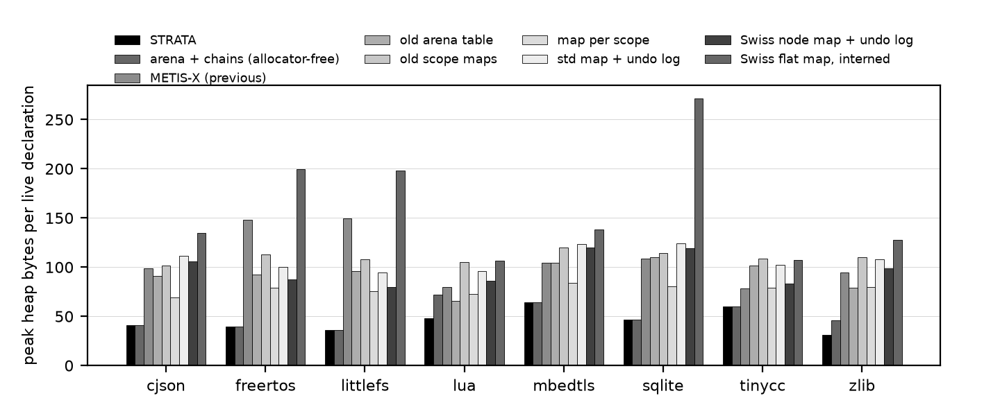
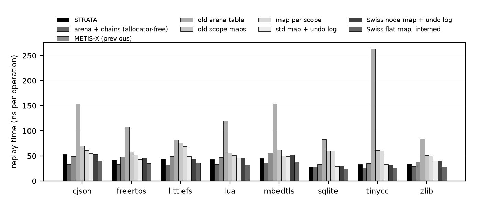

# Results

Run `20261011-165103-v3` (31 paired rounds per trace). Generated by `scripts/make_report.py`; every number is computed from `results/summary/20261011-165103-v3/`, `results/raw/20261011-165103-v3/` and `results/embedded/`. Full tables: `results/summary/20261011-165103-v3/tables.md`.

```
run: results/raw/20261011-165103-v3
date_utc: 2026-10-11T16:51:36Z
git_commit: 8786eacda9f4dbd1d9ba48c7495aa40b5a1bd4f4
compiler: g++ (Ubuntu 11.4.0-1ubuntu1~22.04.3) 11.4.0
flags: -std=c++14 -O2
kernel: Linux 6.18.33.2-microsoft-standard-WSL2
cpu: Intel(R) Core(TM) Ultra 7 258V
libc: ldd (Ubuntu GLIBC 2.35-0ubuntu3.15) 2.35
pinning: taskset -c 2
repetitions: 31 (+2 warm-up) whole-trace replays; 3 per-operation latency replays
metis: 7b3dacfa5405ec3e6a03b718f485b473d779123d
phmap: v1.4.1
```

Reduction always means `(baseline - STRATA) / baseline x 100`. A negative reduction means STRATA is worse. Time reductions are medians of per-round reductions (each round replays every table once, in rotating order) with a 95% bootstrap interval; "established" means the interval excludes zero.

## 1. Summary

| Question | Outcome |
|---|---|
| Correct? | 96 of 96 compiler pairs, 107 of 108 synthetic pairs and 44 of 44 legacy pairs agree with the reference model. The only failures are METIS-X on `deep_shadow_400`. |
| Memory vs METIS-X | Peak heap 23.3 to 75.9% lower (median 57.6%). Allocator calls 98.7 to 99.9% fewer. |
| Time vs METIS-X | Replay time lower on 7 of 8 traces (established), higher on 1 (cjson). Range -6.0 to 18.6%, median 10.7%. |
| Latency vs METIS-X (p95) | Declare: lower on every trace (lower on 8 of 8, reduction 44.0 to 64.1%). Scope exit: lower on every trace (lower on 8 of 8, reduction 66.9 to 88.3%). Lookup: mixed (lower on 3 of 8, reduction -25.5 to 28.2%). |
| **Against a conventional allocator-free table** (`arena_chain`) | **Memory:** STRATA's minimum fixed buffer is 16.4 to 17.9% smaller. **Time:** STRATA is slower on 7 of 8 compiler traces (established), by a median of 29.5%. On the synthetic traces it is faster on 5 and slower on 3 of 9. |
| Where do the gains over METIS-X come from? | Mostly from dropping per-name allocations and 32-byte per-declaration slots, which the conventional table also does: its fixed buffer alone is 55.1 to 77.3% below METIS-X's peak heap. STRATA's own design accounts for the further 16.4 to 17.9%. |
| Fixed memory | A whole project replays from a buffer of 15.8 to 156.5 KiB (27 to 36 bytes per live declaration), no allocator. |
| On a 32-bit embedded target? | Emulated only: 5 traces replay on a bare-metal Cortex-M3 under QEMU with 64 KiB RAM and no heap; results equal the host's; 792 bytes of stack; 2557 bytes of table code. Not run on hardware. |
| 85% target | Met for allocator calls vs METIS-X. Memory: not met against METIS-X (best 75.9% heap, 81.3% fixed buffer); met only against the interning Swiss map, on 2 of 8 traces. Latency: scope-exit p95 vs METIS-X reaches 88% at best; no other time metric comes close. |
| Fastest table overall | The interning Swiss flat map: faster than STRATA on 8 of 8 traces (established), by a median of 21.5%. STRATA's peak heap is 43.6 to 82.7% lower than its. |

## 2. Review points and what the data now says

| Review point | Action | Result |
|---|---|---|
| 1. Limited novelty | Claim narrowed (`RELATED_WORK.md`): no new algorithm. The contributions are the measured decomposition in section 4, bounded-memory guarantees with tests, and compiler-generated traces. | Self-assessed novelty stays at about 4.5/10. |
| 2. Mixed performance (slow scope exit, 30% slowdown on a large scope) | Undo entries now record the index slot, so scope exit empties slots without re-hashing; shrinking waits for 64 calm scope exits. | Scope-exit p95 is now 66.9 to 88.3% **lower** than METIS-X's (it was 13-58% higher). `big_scope_exit`: STRATA 50.4 ns/op against METIS-X 97.4 (it was 30% slower). Lookup p95 is still mixed. |
| 3. Weak timing confidence | 31 rounds instead of 15 repetitions; all tables interleaved within a round in rotating order; statistics on per-round paired differences with bootstrap intervals. | Against METIS-X: 7 of 8 traces established faster, 1 established slower. The interquartile range of raw replay times is still 16% of the median (median over pairs), which is why pairing is needed. |
| 4. No strong allocator-free baseline | Added `arena_chain`: a chained hash table over an entry arena in one buffer, with STRATA's storage discipline. | The concern was justified: it captures most of the gain over METIS-X and is faster than STRATA on plain C traces (section 4). |
| 5. No embedded validation | Bare-metal Cortex-M3 build, run under QEMU with 64 KiB RAM. | Passes on 5 traces (section 6). Still an emulator, not a device; no timing is taken from it. |
| 6. Correctness of the guarantees | State digest compared before and after every refused operation in 30 configurations, including all keys in one probe cluster and deep shadowing; written argument. | `docs/CORRECTNESS.md`; 1 856 579 checks pass at -O2 and under ASan + UBSan. |

## 3. Compiler traces: STRATA against METIS-X

| trace    |   units |    ops |   declares |   lookups |   enters |   distinct_names |   peak_live_decls |   peak_live_distinct |   max_depth |
|:---------|--------:|-------:|-----------:|----------:|---------:|-----------------:|------------------:|---------------------:|------------:|
| cjson    |       2 |  20874 |       5247 |      9194 |     3216 |             1366 |              1067 |                 1067 |          10 |
| freertos |       9 |  37875 |      10346 |     17417 |     5052 |             2226 |              1505 |                 1505 |          16 |
| littlefs |       2 |  21080 |       3835 |     12230 |     2507 |             1001 |               732 |                  732 |          16 |
| lua      |      34 | 188509 |      58619 |     86887 |    21485 |             3622 |              1365 |                 1365 |          14 |
| mbedtls  |     105 | 983008 |     319886 |    438876 |   112071 |             7622 |              2302 |                 2302 |          14 |
| sqlite   |       1 | 268960 |      27072 |    172426 |    34731 |             7801 |              4245 |                 4245 |          22 |
| tinycc   |       1 |  89135 |      13776 |     54623 |    10368 |             6704 |              5509 |                 5508 |          27 |
| zlib     |      15 |  58058 |      16341 |     27405 |     7149 |             1041 |               571 |                  571 |          23 |

| trace    |   peak heap KiB old |   new |   peak heap red. % |   allocs old |   allocs new |   allocs red. % |   replay ms old |   replay ms new |   replay red. % |   CI low |   CI high | established   |   lookup p95 old |   lookup p95 new |   lookup p95 red. % |   declare p95 red. % |   exit p95 red. % |   old refused |
|:---------|--------------------:|------:|-------------------:|-------------:|-------------:|----------------:|----------------:|----------------:|----------------:|---------:|----------:|:--------------|-----------------:|-----------------:|--------------------:|---------------------:|------------------:|--------------:|
| cjson    |               102.7 |  42.8 |               58.3 |         3604 |           22 |            99.4 |             1   |             1.1 |            -6   |    -20.8 |      -1   | yes           |             64.7 |             68.4 |                -5.7 |                 47.2 |              83.2 |             0 |
| freertos |               217.3 |  57.8 |               73.4 |         8282 |           81 |            99   |             1.8 |             1.6 |            14.4 |     10.2 |      18.3 | yes           |             59.3 |             53.2 |                10.3 |                 57   |              77.3 |             0 |
| littlefs |               106.9 |  25.8 |               75.9 |         2774 |           19 |            99.3 |             1   |             0.9 |            11.2 |      7.1 |      18.5 | yes           |             58.1 |             59.9 |                -3.1 |                 63   |              88.3 |             0 |
| lua      |               106.8 |  64.2 |               39.9 |        40494 |          336 |            99.2 |             9   |             8.2 |             8.8 |      3   |      14.6 | yes           |             52.1 |             65.4 |               -25.5 |                 44   |              66.9 |             0 |
| mbedtls  |               234.4 | 144.3 |               38.5 |       255849 |         1154 |            99.5 |            54.6 |            44.8 |            18.6 |     16.4 |      21.1 | yes           |             83.9 |             60.2 |                28.2 |                 64.1 |              81.1 |             0 |
| sqlite   |               451   | 194.7 |               56.8 |        22711 |           15 |            99.9 |             8.8 |             7.8 |            10.7 |      4.5 |      17.7 | yes           |             63   |             50.9 |                19.2 |                 56   |              69.7 |             0 |
| tinycc   |               423.1 | 324.5 |               23.3 |         9665 |           15 |            99.8 |             3.1 |             2.9 |             5.4 |      2.1 |      13.3 | yes           |             50.9 |             52.7 |                -3.5 |                 55.1 |              71.5 |             0 |
| zlib     |                52.7 |  17.2 |               67.3 |        10412 |          133 |            98.7 |             2.2 |             2   |            10.7 |      3.8 |      14.9 | yes           |             44.7 |             44.7 |                 0   |                 52.9 |              72.3 |             0 |

Sources: `compiler_old_vs_new.csv`; raw: `compiler_summary.csv`, `compiler_replays.csv`; program: `benchmarks/bench_main.cpp`.

## 4. Decomposition: METIS-X, a conventional allocator-free table, STRATA

`arena_chain` stores one entry per declaration with the unpacked name, links entries in hash chains and pops them at scope exit. It lives in one buffer like STRATA. Memory is compared in fixed-buffer mode (smallest buffer that replays the trace), because growth in 1.5x steps quantises peak heap.

| trace    |   METIS-X peak heap KiB |   arena+chains fixed buffer KiB |   STRATA fixed buffer KiB |   memory: arena+chains vs METIS-X, red. % |   memory: STRATA vs arena+chains, red. % |   time: arena+chains vs METIS-X, red. % |   time: STRATA vs METIS-X, red. % |   time: STRATA vs arena+chains, red. % |   CI low |   CI high |
|:---------|------------------------:|--------------------------------:|--------------------------:|------------------------------------------:|-----------------------------------------:|----------------------------------------:|----------------------------------:|---------------------------------------:|---------:|----------:|
| cjson    |                   102.7 |                            35.9 |                      30   |                                      65.1 |                                     16.4 |                                    34.1 |                              -6   |                                  -63.4 |    -65.6 |     -53.6 |
| freertos |                   217.3 |                            53.6 |                      44   |                                      75.3 |                                     17.9 |                                    33.6 |                              14.4 |                                  -28.3 |    -37   |     -24   |
| littlefs |                   106.9 |                            24.2 |                      20   |                                      77.3 |                                     17.5 |                                    34.7 |                              11.2 |                                  -35.3 |    -42.5 |     -24.6 |
| lua      |                   106.8 |                            43.4 |                      35.9 |                                      59.3 |                                     17.3 |                                    28.9 |                               8.8 |                                  -33.5 |    -39   |     -22.6 |
| mbedtls  |                   234.4 |                            96.9 |                      80   |                                      58.7 |                                     17.4 |                                    36.3 |                              18.6 |                                  -30.6 |    -33.1 |     -23.8 |
| sqlite   |                   451   |                           169.4 |                     140.4 |                                      62.4 |                                     17.2 |                                    11.4 |                              10.7 |                                   -2.9 |     -6.6 |       5.6 |
| tinycc   |                   423.1 |                           189.8 |                     156.5 |                                      55.1 |                                     17.5 |                                    24   |                               5.4 |                                  -23.4 |    -27.3 |     -20.4 |
| zlib     |                    52.7 |                            18.9 |                      15.8 |                                      64.2 |                                     16.6 |                                    22.6 |                              10.7 |                                  -14.3 |    -31.5 |     -10.2 |

* Memory: going from METIS-X to the conventional table removes 55.1 to 77.3%; STRATA removes a further 16.4 to 17.9% of what is left.
* Time: the conventional table is faster than METIS-X by 11.4 to 36.3%; STRATA by -6.0 to 18.6%. STRATA is established slower than the conventional table on cjson, freertos, littlefs, lua, mbedtls, tinycc, zlib, and established faster on no trace.
* On the synthetic traces STRATA is established faster than the conventional table on big_scope_exit, deep_shadow_400, scope_churn, shadow_heavy, short_ids and slower on dense_50k, long_ids, lookup_heavy.

Reading: on C code as TCC compiles it there is almost no shadowing at the memory peak, so storing a name once saves nothing there; STRATA's memory advantage comes from the smaller record (8-byte header and packed name against a 16-byte header and raw name). Its time disadvantage comes from packing the query and from probing an open-addressing index instead of following a short chain that stores full hashes. These two causes were not measured separately.

## 5. All tables

Peak heap, KiB:

| trace    |   STRATA |   arena+chains |   METIS-X |   map/scope |   std+undo |   Swiss+undo |   Swiss int. |
|:---------|---------:|---------------:|----------:|------------:|-----------:|-------------:|-------------:|
| cjson    |     42.8 |           42.8 |     102.7 |        72   |      116   |        110   |        140.4 |
| freertos |     57.8 |           57.7 |     217.3 |       116   |      147.3 |        128.8 |        293   |
| littlefs |     25.8 |           25.7 |     106.9 |        54.1 |       67.8 |         57.1 |        141.9 |
| lua      |     64.2 |           96.2 |     106.8 |        96.7 |      127.7 |        114.7 |        142.3 |
| mbedtls  |    144.3 |          144.2 |     234.4 |       189.4 |      277.7 |        269.3 |        310.9 |
| sqlite   |    194.7 |          194.7 |     451   |       332.9 |      513.4 |        494   |       1125.6 |
| tinycc   |    324.5 |          324.4 |     423.1 |       424.5 |      550.9 |        449.6 |        575.6 |
| zlib     |     17.2 |           25.7 |      52.7 |        44.4 |       60.3 |         55   |         71.1 |

Replay time, ns per trace operation (median of 31 rounds):

| trace    |   STRATA |   arena+chains |   METIS-X |   map/scope |   std+undo |   Swiss+undo |   Swiss int. |   STRATA sparse |   STRATA raw |   STRATA no-shrink |
|:---------|---------:|---------------:|----------:|------------:|-----------:|-------------:|-------------:|----------------:|-------------:|-------------------:|
| cjson    |     53.4 |           33.1 |      49.7 |        60.8 |       55   |         53.2 |         39.6 |            43.8 |         48.8 |               49.7 |
| freertos |     42.9 |           33.1 |      48.6 |        52.6 |       43   |         46.6 |         35.1 |            35.5 |         45   |               41.3 |
| littlefs |     44.2 |           32   |      49.5 |        69.3 |       49.5 |         44.5 |         36.6 |            36.3 |         44.7 |               43.2 |
| lua      |     43.5 |           33   |      47.6 |        51.2 |       46   |         46.4 |         32.3 |            38.3 |         43.6 |               44.2 |
| mbedtls  |     45.5 |           35.4 |      55.6 |        51.1 |       49.6 |         52.8 |         38.1 |            39.9 |         46.2 |               44.8 |
| sqlite   |     29   |           28.9 |      32.7 |        60.3 |       29.4 |         30.6 |         25   |            28.5 |         29.4 |               29.7 |
| tinycc   |     33   |           26.5 |      35   |        60.1 |       33.3 |         31.5 |         26.4 |            28.8 |         36.8 |               32.9 |
| zlib     |     33.7 |           29.3 |      37.5 |        49.8 |       39.8 |         40.1 |         28.7 |            30   |         34.9 |               33.3 |

STRATA against each baseline (range over the 8 traces; time from paired rounds):

| baseline                        |   traces |   faster (established) |   slower (established) |   peak heap red. % min |   median |   max |   replay time red. % min |   median  |   max  |
|:--------------------------------|---------:|-----------------------:|-----------------------:|-----------------------:|---------:|------:|-------------------------:|----------:|-------:|
| arena + chains (allocator-free) |        8 |                      0 |                      7 |                   -0.2 |     -0   |  33.2 |                    -63.4 |     -29.5 |   -2.9 |
| METIS-X (previous)              |        8 |                      7 |                      1 |                   23.3 |     57.6 |  75.9 |                     -6   |      10.7 |   18.6 |
| old arena table                 |        8 |                      8 |                      0 |                   26.6 |     56.1 |  62.4 |                     45.7 |      63.7 |   87.1 |
| old scope maps                  |        8 |                      8 |                      0 |                   44.6 |     59.2 |  72   |                     22.5 |      30.6 |   52.1 |
| map per scope                   |        8 |                      8 |                      0 |                   23.6 |     41   |  61.2 |                      9.9 |      24   |   50.2 |
| std map + undo log              |        8 |                      4 |                      0 |                   41.1 |     61.4 |  71.5 |                     -0.8 |       3.4 |   13.3 |
| Swiss node map + undo log       |        8 |                      4 |                      0 |                   27.8 |     55   |  68.7 |                     -5.8 |       5.2 |   13   |
| Swiss flat map, interned        |        8 |                      0 |                      8 |                   43.6 |     72.7 |  82.7 |                    -33.1 |     -21.5 |  -11.3 |

Lookup latency p95, ns:

| trace    |   STRATA |   arena+chains |   METIS-X |   map/scope |   std+undo |   Swiss+undo |   Swiss int. |   STRATA sparse |
|:---------|---------:|---------------:|----------:|------------:|-----------:|-------------:|-------------:|----------------:|
| cjson    |       68 |             56 |        65 |         165 |         95 |           58 |           57 |              64 |
| freertos |       53 |             48 |        59 |         127 |         61 |           51 |           49 |              49 |
| littlefs |       60 |             45 |        58 |         182 |         73 |           53 |           53 |              53 |
| lua      |       65 |             45 |        52 |         110 |         67 |           52 |           55 |              45 |
| mbedtls  |       60 |             75 |        84 |         110 |        105 |           66 |           67 |              55 |
| sqlite   |       51 |             51 |        63 |         164 |         54 |           62 |           84 |              50 |
| tinycc   |       53 |             91 |        51 |         279 |         52 |           47 |           53 |              44 |
| zlib     |       45 |             41 |        45 |         105 |         50 |           43 |           86 |              40 |

Declare latency p95, ns:

| trace    |   STRATA |   arena+chains |   METIS-X |   map/scope |   std+undo |   Swiss+undo |   Swiss int. |   STRATA sparse |
|:---------|---------:|---------------:|----------:|------------:|-----------:|-------------:|-------------:|----------------:|
| cjson    |      104 |             71 |       197 |         142 |        169 |          135 |          112 |              89 |
| freertos |       80 |             80 |       187 |         123 |        124 |          114 |           92 |              68 |
| littlefs |       86 |             60 |       234 |         132 |        160 |          120 |           86 |              73 |
| lua      |       88 |             72 |       157 |         106 |        131 |          115 |           96 |              62 |
| mbedtls  |       86 |             89 |       238 |         126 |        192 |          148 |          133 |              71 |
| sqlite   |       79 |             85 |       181 |         130 |        120 |          109 |          157 |              70 |
| tinycc   |       82 |            102 |       184 |         220 |        114 |          114 |           85 |              63 |
| zlib     |       68 |             69 |       144 |         106 |        113 |          103 |          124 |              53 |

Scope-exit latency p95, ns:

| trace    |   STRATA |   arena+chains |   METIS-X |   map/scope |   std+undo |   Swiss+undo |   Swiss int. |   STRATA sparse |
|:---------|---------:|---------------:|----------:|------------:|-----------:|-------------:|-------------:|----------------:|
| cjson    |       14 |             22 |        83 |          53 |        173 |          160 |           11 |              13 |
| freertos |       20 |             27 |        88 |          66 |        153 |          153 |           17 |              19 |
| littlefs |       17 |             23 |       144 |          64 |        193 |          177 |           14 |              17 |
| lua      |       27 |             26 |        81 |          54 |        170 |          163 |           18 |              19 |
| mbedtls  |       28 |             40 |       148 |          77 |        325 |          266 |           19 |              26 |
| sqlite   |       23 |             28 |        76 |          61 |        146 |          142 |           31 |              23 |
| tinycc   |       21 |             37 |        74 |         105 |        133 |          115 |           16 |              20 |
| zlib     |       17 |             22 |        61 |          48 |        141 |          137 |           31 |              16 |

Per-call values are taken with a serialising timestamp read on each side; the calibrated cost of an empty interval (18 ns) is subtracted. They are near the method's resolution: use them to compare tables, not as absolute costs.





## 6. Fixed-buffer mode and the embedded run

| trace    |   min buffer KiB (packed) |   min buffer KiB (raw) |   min buffer KiB (sparse index) |   packing saves % |   bytes per live decl |   arena + chains min buffer KiB |   vs arena + chains, red. % |   vs METIS-X (previous) peak heap, red. % |   vs map per scope peak heap, red. % |   vs std map + undo log peak heap, red. % |   vs Swiss flat map, interned peak heap, red. % |
|:---------|--------------------------:|-----------------------:|--------------------------------:|------------------:|----------------------:|--------------------------------:|----------------------------:|------------------------------------------:|-------------------------------------:|------------------------------------------:|------------------------------------------------:|
| cjson    |                      30   |                   31.8 |                            38   |               5.5 |                  28.8 |                            35.9 |                        16.4 |                                      70.8 |                                 58.3 |                                      74.1 |                                            78.6 |
| freertos |                      44   |                   47.8 |                            52   |               7.9 |                  29.9 |                            53.6 |                        17.9 |                                      79.8 |                                 62.1 |                                      70.1 |                                            85   |
| littlefs |                      20   |                   21.5 |                            24   |               7   |                  28   |                            24.2 |                        17.5 |                                      81.3 |                                 63   |                                      70.5 |                                            85.9 |
| lua      |                      35.9 |                   38.1 |                            43.9 |               5.7 |                  27   |                            43.4 |                        17.3 |                                      66.3 |                                 62.8 |                                      71.8 |                                            74.7 |
| mbedtls  |                      80   |                   87.9 |                            96   |               9   |                  35.6 |                            96.9 |                        17.4 |                                      65.9 |                                 57.8 |                                      71.2 |                                            74.3 |
| sqlite   |                     140.4 |                  152.9 |                           172.4 |               8.2 |                  33.9 |                           169.4 |                        17.2 |                                      68.9 |                                 57.8 |                                      72.7 |                                            87.5 |
| tinycc   |                     156.5 |                  168.3 |                           188.5 |               7   |                  29.1 |                           189.8 |                        17.5 |                                      63   |                                 63.1 |                                      71.6 |                                            72.8 |
| zlib     |                      15.8 |                   16.7 |                            19.8 |               5.6 |                  28.2 |                            18.9 |                        16.6 |                                      70.1 |                                 64.5 |                                      73.9 |                                            77.9 |

Sources: `budget.csv`, `benchmarks/budget_main.cpp`. Tables without a fixed-memory mode are compared through their peak heap.

Bare-metal run (`tools/embedded/run.sh`, log in `results/embedded/qemu_cortex_m3.txt`):

```
compiler: arm-none-eabi-g++ (15:10.3-2021.07-4) 10.3.1 20210621 (release)
emulator: QEMU emulator version 6.2.0 (Debian 1:6.2+dfsg-2ubuntu6.31)
machine: mps2-an385 (Cortex-M3); RAM limited to 64 KiB by tools/embedded/link.ld; no heap, no OS
flags: -mcpu=cortex-m3 -mthumb -Os -fno-exceptions -fno-rtti -fno-threadsafe-statics -ffunction-sections -fdata-sections -Wl,--gc-sections
```

| trace    |   operations |   buffer bytes |   peak used bytes |   stack bytes |   refused | checksum equals host   |   STRATA code bytes |
|:---------|-------------:|---------------:|------------------:|--------------:|----------:|:-----------------------|--------------------:|
| zlib     |        58058 |          16384 |             16128 |           792 |         0 | yes                    |                2557 |
| littlefs |        21080 |          20480 |             20468 |           792 |         0 | yes                    |                2557 |
| cjson    |        20874 |          30720 |             30704 |           792 |         0 | yes                    |                2557 |
| lua      |       188509 |          36864 |             36776 |           792 |         0 | yes                    |                2557 |
| freertos |        37875 |          45056 |             45008 |           792 |         0 | yes                    |                2557 |

The buffer is the measured minimum rounded up to a whole KiB. `malloc`, `free` and `realloc` are stubs that fail, so the run also shows that fixed mode calls no allocator. QEMU is an instruction-level emulator: this demonstrates that the code builds for and runs correctly on a 32-bit Cortex-M3 within 64 KiB of RAM; it says nothing about speed on real hardware. The three larger traces need more than 64 KiB and were not run.

## 7. Options

| Option | Effect on the compiler traces |
|---|---|
| Name packing (`strata` vs `strata_raw`) | minimum buffer 5.5 to 9.0% smaller; replay time from 4.4% slower to 12.1% faster with packing (paired medians) |
| Sparse index (`strata_sparse`, at most half full) | replay time 2.4 to 17.6% lower (median 14.4%); minimum buffer 18.2 to 26.7% larger |
| No shrinking (`strata_noshrink`) | `big_scope_exit`: 49.7 ns/op against 50.4 with shrinking |

## 8. Synthetic stress traces

| trace           |   peak heap KiB old |    new |   peak heap red. % |   allocs old |   allocs new |   allocs red. % |   replay ms old |   replay ms new |   replay red. % |   CI low |   CI high | established   |   lookup p95 old |   lookup p95 new |   lookup p95 red. % |   declare p95 red. % |   exit p95 red. % |   old refused |
|:----------------|--------------------:|-------:|-------------------:|-------------:|-------------:|----------------:|----------------:|----------------:|----------------:|---------:|----------:|:--------------|-----------------:|-----------------:|--------------------:|---------------------:|------------------:|--------------:|
| big_scope_exit  |               868.2 |  486.6 |               44   |       104082 |           17 |           100   |            19.5 |            10.1 |            49.7 |     45.7 |      51.2 | yes           |              0   |              0   |               nan   |                 59.8 |              95.7 |             0 |
| deep_nesting    |                57.1 |   25.8 |               54.9 |       103095 |           10 |           100   |            18.8 |            12.5 |            32.7 |     27.8 |      36.5 | yes           |             63   |             52.1 |                17.3 |                 64.2 |              80   |             0 |
| deep_shadow_400 |                40.1 |   11.5 |               71.3 |          268 |           10 |            96.3 |             0.5 |             0   |            94.5 |     94.4 |      94.5 | yes           |            552.2 |             18.2 |                96.7 |                 96.4 |              93.6 |           149 |
| dense_50k       |              6972.3 | 2462.9 |               64.7 |        26613 |           21 |            99.9 |            22.4 |            21.3 |             0.7 |     -3.1 |       9.1 | no            |            309.5 |            315.5 |                -1.9 |                 48.5 |             nan   |             0 |
| long_ids        |               297.1 |  216.4 |               27.2 |       130673 |           14 |           100   |            40.3 |            24   |            39.4 |     35.8 |      42   | yes           |            148.4 |            116.9 |                21.2 |                 52.1 |              82.1 |             0 |
| lookup_heavy    |                53.7 |   25.8 |               52   |        16720 |           10 |            99.9 |            12.3 |            12.8 |            -2   |     -3.5 |       1.8 | no            |             59.3 |             76.9 |               -29.7 |                 48.8 |              75.5 |             0 |
| scope_churn     |                 6.4 |    3.9 |               39   |       119411 |            4 |           100   |            16.9 |            12.3 |            29.4 |     23.9 |      33.4 | yes           |             61.8 |             49.1 |                20.6 |                 61.2 |              82.2 |             0 |
| shadow_heavy    |                26.7 |    4.9 |               81.5 |        73820 |           16 |           100   |            22   |            10.7 |            52.2 |     49.5 |      55.4 | yes           |            100.6 |             38.2 |                62   |                 71.3 |              80.8 |             0 |
| short_ids       |               200.8 |   64.2 |               68   |        43608 |           12 |           100   |            15.9 |            10.9 |            29.9 |     27.3 |      33   | yes           |             53.3 |             49.1 |                 7.9 |                 62.6 |              71.5 |             0 |

* `deep_shadow_400`: METIS-X refused 149 of 400 declarations and gave 298 wrong lookup results. No other table failed.
* Established slower than METIS-X on: no trace. Not established either way on: dense_50k, lookup_heavy.

Replay time, ns per operation:

| trace           |   STRATA |   arena+chains |   METIS-X |   map/scope |   std+undo |   Swiss+undo |   Swiss int. |   STRATA sparse |   STRATA no-shrink |
|:----------------|---------:|---------------:|----------:|------------:|-----------:|-------------:|-------------:|----------------:|-------------------:|
| big_scope_exit  |     50.4 |           75.2 |      97.4 |       142.4 |      133.2 |        101.6 |         50.9 |            41.3 |               49.7 |
| deep_nesting    |     41.6 |           45.6 |      62.5 |       465   |       54.9 |         51.1 |         34.4 |            38.9 |               42.1 |
| deep_shadow_400 |     12.5 |           17   |     226.4 |        21.9 |       12.2 |          9.6 |          9.4 |             8.8 |                8.6 |
| dense_50k       |     85.2 |           67.4 |      89.6 |        88.3 |       86.9 |         71.7 |         62.3 |            82.5 |               84.8 |
| long_ids        |     79.8 |           72.3 |     134.3 |       156   |       77.3 |         59.9 |         45.7 |            77.2 |               80.8 |
| lookup_heavy    |     42.6 |           37   |      40.9 |       101.2 |       42   |         35.1 |         35.3 |            36.3 |               41.1 |
| scope_churn     |     37.1 |           49   |      51.1 |        49.4 |       66.6 |         46.8 |         29.3 |            36.7 |               36.2 |
| shadow_heavy    |     35.6 |           41.6 |      73.4 |        77.9 |       44   |         33.6 |         33.5 |            32.5 |               35.3 |
| short_ids       |     36.3 |           39.7 |      52.8 |        99   |       50.1 |         37.6 |         30.1 |            33.5 |               35.7 |

Peak heap, KiB:

| trace           |   STRATA |   arena+chains |   METIS-X |   map/scope |   std+undo |   Swiss+undo |   Swiss int. |
|:----------------|---------:|---------------:|----------:|------------:|-----------:|-------------:|-------------:|
| big_scope_exit  |    486.6 |          486.6 |     868.2 |       708.1 |      972.4 |        926.7 |       1164.5 |
| deep_nesting    |     25.8 |           25.7 |      57.1 |        71.2 |       61   |         54   |        264.2 |
| deep_shadow_400 |     11.5 |           11.5 |      40.1 |        90.6 |       13.3 |         13.2 |         10.2 |
| dense_50k       |   2462.9 |         2462.9 |    6972.3 |      3788.7 |     4812.7 |       4047.6 |       4671.2 |
| long_ids        |    216.4 |          216.3 |     297.1 |       249.4 |      269.8 |        270.3 |        381.1 |
| lookup_heavy    |     25.8 |           25.7 |      53.7 |        45   |       59.6 |         53.9 |        261   |
| scope_churn     |      3.9 |            3.8 |       6.4 |         3.7 |        4.6 |          4.9 |         64.4 |
| shadow_heavy    |      4.9 |            7.7 |      26.7 |        21.3 |        7.9 |          7.6 |          6.3 |
| short_ids       |     64.2 |           64.1 |     200.8 |       127.9 |      151.4 |        153.5 |        260.2 |

STRATA against each baseline on the synthetic traces:

| baseline                        |   traces |   faster (established) |   slower (established) |   peak heap red. % min |   median |   max |   replay time red. % min |   median  |   max  |
|:--------------------------------|---------:|-----------------------:|-----------------------:|-----------------------:|---------:|------:|-------------------------:|----------:|-------:|
| arena + chains (allocator-free) |        9 |                      5 |                      3 |                   -1.6 |     -0.1 |  35.5 |                    -26.8 |       9.5 |   32.1 |
| METIS-X (previous)              |        9 |                      7 |                      0 |                   27.2 |     54.9 |  81.5 |                     -2   |      32.7 |   94.5 |
| old arena table                 |        9 |                      8 |                      0 |                   10.9 |     95.3 |  99.8 |                      0.4 |      64.4 |   99.4 |
| old scope maps                  |        9 |                      9 |                      0 |                   28.9 |     59.9 |  88.8 |                     11.4 |      58   |   91.2 |
| map per scope                   |        9 |                      8 |                      0 |                   -4.6 |     42.8 |  87.3 |                      2.3 |      53.7 |   90.6 |
| std map + undo log              |        9 |                      5 |                      1 |                   13.3 |     48.8 |  57.8 |                     -3.5 |      18.2 |   61.4 |
| Swiss node map + undo log       |        9 |                      4 |                      4 |                   12.8 |     39.2 |  58.2 |                    -31.8 |      -7.6 |   50.8 |
| Swiss flat map, interned        |        9 |                      0 |                      8 |                  -12.5 |     58.2 |  94   |                    -76.3 |     -20.4 |   -3.1 |

## 9. Worst case: all keys in one probe cluster

|   live_names | hash                 |   ns_per_lookup_hit |   ns_per_lookup_miss |   ns_per_declare |
|-------------:|:---------------------|--------------------:|---------------------:|-----------------:|
|           16 | normal               |                 8.9 |                  8.1 |            130.3 |
|           16 | all_keys_one_cluster |                10.9 |                 15.5 |            144.1 |
|           64 | normal               |                10.1 |                  8.5 |            133.6 |
|           64 | all_keys_one_cluster |                30   |                 54.2 |            229.7 |
|          256 | normal               |                10.6 |                  8.6 |            103.5 |
|          256 | all_keys_one_cluster |               108.7 |                213.8 |            471.5 |
|         1024 | normal               |                11.3 |                 10.2 |            127.5 |
|         1024 | all_keys_one_cluster |               420.1 |                807.7 |           2236.4 |
|         4096 | normal               |                13.7 |                 18.7 |             98   |
|         4096 | all_keys_one_cluster |              1587.5 |               3125.5 |           6064.3 |

Results stay correct (tests), but a lookup scans the cluster: cost grows linearly. STRATA has no defence against adversarial keys.

## 10. Regex-extracted traces of the earlier work (supplemental)

These come from a lexical heuristic, not a compiler; shown for continuity with the METIS-X manuscript. `arena_chain` was not run on the two large ones.

| trace    |   peak heap KiB old |    new |   peak heap red. % |   allocs old |   allocs new |   allocs red. % |   replay ms old |   replay ms new |   replay red. % |   CI low |   CI high | established   |   lookup p95 old |   lookup p95 new |   lookup p95 red. % |   declare p95 red. % |   exit p95 red. % |   old refused |
|:---------|--------------------:|-------:|-------------------:|-------------:|-------------:|----------------:|----------------:|----------------:|----------------:|---------:|----------:|:--------------|-----------------:|-----------------:|--------------------:|---------------------:|------------------:|--------------:|
| Arduino  |               877   |  292   |               66.7 |        19804 |           16 |            99.9 |             6.1 |             4.1 |            32.9 |    -72.8 |      40.6 | no            |             58.2 |             52.7 |                 9.5 |                 58.8 |              83.3 |             0 |
| ESP-IDF  |             15375.6 | 7480.9 |               51.3 |       629511 |           24 |           100   |           191   |           150.4 |            19.7 |    -10.3 |      36   | no            |            115.7 |             69   |                40.4 |                 65   |              88.3 |             0 |
| FreeRTOS |               937.6 |  292   |               68.9 |        32473 |           16 |           100   |            10.2 |             9   |            11.5 |     -8.9 |      39.2 | no            |             69   |             53.9 |                21.9 |                 52   |              79.3 |             0 |
| Zephyr   |              7572.2 | 1870.3 |               75.3 |       664319 |           25 |           100   |           187.8 |           107.3 |            42.5 |     33.9 |      49   | yes           |             85.4 |             68.4 |                19.9 |                 57.8 |              80   |             0 |

## 11. STRATA as first reported (version 1) and now

Version 1: run `20261011-161306-final`. Changes since: slot recorded in the undo entry (scope exit without re-hashing), delayed shrinking, hash computed while packing. The versions were measured in different runs and with different protocols: version 1 replayed one table 15 times in a row, the present run interleaves 12 tables, so each replay starts with colder caches and the absolute ns/op of the small traces is higher now. Compare the latency columns and the buffer sizes, not the replay columns.

| trace    |   exit p95 ns v1 |   now |   red. % |   declare p95 ns v1 |   now  |   lookup p95 ns v1 |   now   |   replay ns/op v1 |   now    |   min buffer KiB v1 |   now     |
|:---------|-----------------:|------:|---------:|--------------------:|-------:|-------------------:|--------:|------------------:|---------:|--------------------:|----------:|
| cjson    |             92.1 |  13.9 |     84.9 |                74.5 |  104.1 |               52.7 |    68.4 |              32.2 |     53.4 |                30   |      30   |
| freertos |            117.5 |  20   |     83   |                82.4 |   80.5 |               55.7 |    53.2 |              39.2 |     42.9 |                44   |      44   |
| littlefs |            123.5 |  16.9 |     86.3 |                89.6 |   86.5 |               58.1 |    59.9 |              29.8 |     44.2 |                20   |      20   |
| lua      |            129.6 |  26.7 |     79.4 |                95.7 |   87.8 |               78.7 |    65.4 |              38.7 |     43.5 |                35.9 |      35.9 |
| mbedtls  |            171.4 |  28   |     83.7 |                98.1 |   85.7 |               71.5 |    60.2 |              46.7 |     45.5 |                80   |      80   |
| sqlite   |            100.5 |  23   |     77.1 |                84.2 |   79.4 |               56.9 |    50.9 |              30   |     29   |               140.4 |     140.4 |
| tinycc   |            121.1 |  21.2 |     82.5 |               145.9 |   82.4 |               61.7 |    52.7 |              33.6 |     33   |               156.5 |     156.5 |
| zlib     |             97.5 |  16.9 |     82.7 |                69.7 |   67.7 |               47.8 |    44.7 |              27.8 |     33.7 |                15.8 |      15.8 |

`big_scope_exit`: STRATA 137.9 ns/op in version 1 (METIS-X 105.9 in that run), 50.4 now (METIS-X 97.4).

## 12. Run-to-run variation

Two complete runs of identical version-1 code are kept (`20261011-160113-full`, `20261011-161306-final`): 189 of 208 table/trace pairs have the same peak heap to within 64 bytes; their median replay times differ by a median of 4.8% and by up to 73%. In the present run the interquartile range of the 31 rounds is 15.6% of the median (median over pairs; maximum 39%). This is why time comparisons here are made on rounds paired within one run and stated with intervals.
